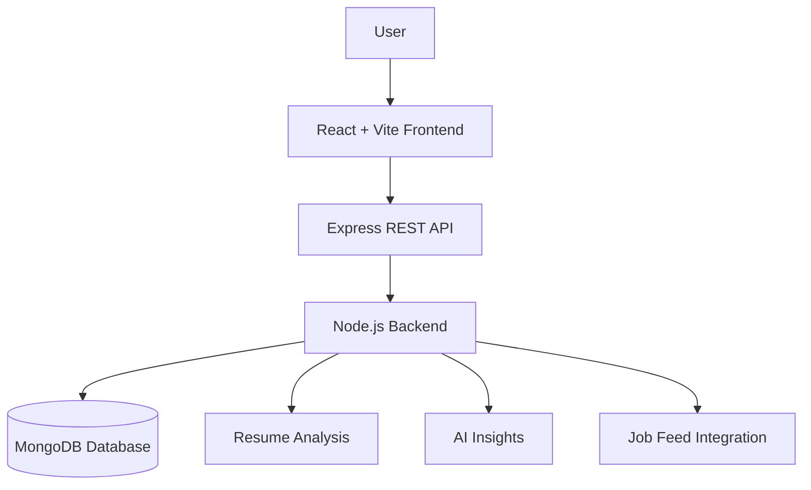

<p align="center">
  
</p>

<p align="center">
  <i>✧ Your all-in-one workspace for smarter job tracking and recruitment ✧</i>
</p>

<p align="center">
  
  
  
</p>

---

**HireTrack** is a full-stack job tracking platform that simplifies application management, resume analysis, and hiring workflows through an intuitive, modern interface.

# ✦ HireTrack

<p align="center">
  
</p>

<p align="center">
  A modern, full-stack platform designed to streamline job applications, candidate management, and recruitment workflows — all in one place.
</p>

<p align="center">
  
  
  
  
  
  
</p>

---

## ✨ Overview

**HireTrack** brings job application tracking and recruitment management into a centralized workspace. It helps users organize applications, monitor hiring stages, analyze resumes, and gain insights into their hiring pipeline.

Whether you're managing your personal job search or organizing candidate workflows, HireTrack aims to make the process more structured and efficient.

## 🌟 Key Features

| Feature | Description |
|---|---|
| 📊 **Smart Dashboard** | Monitor applications and track recruitment progress. |
| 📄 **Resume Parsing & Analysis** | Extract and analyze relevant information from resumes. |
| 🗂️ **Kanban Pipeline** | Organize candidates or applications by hiring stage. |
| 💼 **Job Feed Integration** | Bring job opportunities into your workflow. |
| 🤖 **AI-Powered Insights** | Support smarter decisions with AI-based analysis. |

## 🖥️ Tech Stack

**Frontend**
- React — component-based UI
- Vite — fast development and builds
- Tailwind CSS — utility-first styling

**Backend**
- Node.js — JavaScript runtime
- Express.js — REST API framework
- MongoDB — document-oriented database

## 🏗️ Architecture



## ⚡ Getting Started

### Prerequisites

Make sure you have installed:
- [Node.js](https://nodejs.org/)
- npm
- MongoDB or a configured MongoDB Atlas connection

### Installation

**1. Clone the repository**

```bash
git clone <your-repository-url>
cd HireTrack
```

**2. Install frontend dependencies**

```bash
npm install
```

**3. Install backend dependencies**

```bash
cd backend
npm install
cd ..
```

**4. Configure environment variables**

Create the required `.env` file(s) based on your project configuration. Add your MongoDB connection string and any required API keys.

Never commit secrets or credentials to GitHub.

**5. Start the application**

```bash
npm run dev:all
```

> Ensure that `dev:all` is configured in your root `package.json` to start both the frontend and backend concurrently.

## 📁 Project Structure

```text
HireTrack/
├── backend/
│   ├── routes/
│   ├── controllers/
│   ├── models/
│   └── server.js
├── src/
│   ├── components/
│   ├── pages/
│   ├── assets/
│   └── App.jsx
├── public/
├── package.json
└── README.md
```

*Adjust the structure above to match your actual repository.*

## 🔮 Future Enhancements

- [ ] Advanced application analytics
- [ ] Resume-to-job matching scores
- [ ] Automated application reminders
- [ ] Customizable recruitment pipelines
- [ ] Enhanced reporting and export options

## 🤝 Contributing

Contributions, suggestions, and bug reports are welcome!

1. Fork the repository.
2. Create a feature branch.
3. Commit your changes.
4. Open a pull request.

## 👩‍💻 Built With

Built with ❤️ using the MERN ecosystem and modern frontend tooling.

---

<p align="center">
  ⭐ If you find HireTrack useful, consider starring the repository!
</p>
